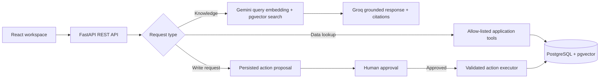

# AI Support & Operations Agent

An internal support workspace that combines a knowledge assistant, customer and ticket tools, bulk data import, and a reviewable action workflow. Support staff can ask questions about uploaded PDF documents, look up customer and ticket records, and prepare supported changes for human review.

The application is built around a simple rule: **AI can prepare an action, but a person must approve it before it is executed.** The model does not receive direct database access; requests are routed through application code and validated tools.

> This repository is an application foundation, not a hosted service. A production deployment still needs operator-managed hosting, secrets, HTTPS, backups, monitoring, and verification against the target database and AI accounts.

## Features

- **Knowledge assistant:** Upload text-based PDFs, extract and chunk their text, create Gemini embeddings, search with PostgreSQL and pgvector, and answer from retrieved passages with document citations. Questions without sufficient evidence receive a fixed “not enough information” response.
- **Customer and ticket workspace:** Search and browse customers and tickets, view a customer’s tickets, create and update supported records, and paginate large result lists.
- **Bulk CSV import:** Preview and validate customer and ticket files before importing. Duplicate customer emails are skipped. Ticket imports use a stable `external_id` to make retries idempotent.
- **Action proposals:** The assistant can currently propose ticket creation. Proposals are saved for review; authorized staff can approve or reject them, and only an approved proposal can be executed. Execution is protected against repeated execution and uses a database transaction.
- **Workspace accounts and roles:** Admins manage accounts and audit events. Admins and agents can use the assistant and manage support data; viewers have read-only access to permitted pages and endpoints. Users can change their password.
- **Chat history and audit events:** Conversations are saved per user. Audit events record authentication and selected workspace changes without saving chat message content in the audit metadata.
- **Operations support:** Docker Compose, Alembic migrations, seed scripts, database backup and restore scripts, and GitHub Actions CI are included.

## How it works



### Knowledge workflow

```text
PDF upload → signature/size checks → pypdf text extraction → chunking
→ Gemini document embeddings → PostgreSQL/pgvector

Question → Gemini query embedding → nearest chunks → relevance checks
→ Groq structured, context-grounded answer → answer and source references
```

The current pipeline extracts embedded PDF text; it does not perform OCR on scanned pages. The source PDF itself is not retained: the database stores its filename, content hash, and extracted/indexed chunks.

### Action workflow

```text
proposed → approved → executed
    └────→ rejected
```

The executor only accepts approved proposals, locks the proposal row, and commits the supported write and status transition together. The currently implemented AI write action is `create_ticket`.

## Technology

| Layer | Technology |
|---|---|
| Frontend | React 19, TypeScript, Vite, React Router, Tailwind CSS, Axios |
| API | Python 3.12, FastAPI, Pydantic, SQLAlchemy |
| Database | PostgreSQL 16, pgvector, Alembic |
| AI | Groq for structured chat completions; Gemini for text embeddings |
| Documents | pypdf text extraction |
| Delivery | Docker Compose, Nginx, GitHub Actions |

## Repository layout

```text
backend/
  app/
    core/          Settings, authentication and security helpers
    db/            SQLAlchemy base, engine and session dependency
    models/        Users, customers, tickets, documents, chat, audit and actions
    routers/       FastAPI endpoints
    schemas/       Request and response validation
    services/      AI, RAG, ingestion, orchestration and action execution
  alembic/         Database migration history
  scripts/         Seed, scale-seed, backup and restore utilities
  tests/           Backend unit and integration tests
frontend/
  src/
    api/           Axios client and API modules
    components/    Shared workspace UI components
    pages/         Dashboard, assistant, knowledge, customers, tickets, actions and admin
.github/workflows/ci.yml
docker-compose.yml
```

## Prerequisites

- Python 3.12 for local backend development
- Node.js 22 and npm for the frontend
- Docker Desktop / Docker Engine with Compose for PostgreSQL and the containerized stack
- A Groq API key for chat and a Gemini API key for embeddings

## Local development

### 1. Configure the database

Copy the root `.env.example` to `.env` and set a strong `POSTGRES_PASSWORD`. The local database port is bound to `127.0.0.1`.

```powershell
Copy-Item .env.example .env
docker compose up -d db
```

### 2. Configure and run the API

Copy `backend/.env.example` to `backend/.env`. Set `DATABASE_URL` to use the same password as root `POSTGRES_PASSWORD`; configure fresh AI keys and authentication values. Keep both `.env` files private and out of version control.

```powershell
Copy-Item backend/.env.example backend/.env
cd backend
py -3.12 -m venv .venv
.venv\Scripts\Activate.ps1
python -m pip install -r requirements-lock.txt
alembic upgrade head
python -m scripts.seed_data
uvicorn app.main:app --reload
```

The small seed dataset is for local demonstrations. `python -m scripts.seed_demo_scale` optionally adds synthetic scale-test data; do not use that data as real customer information.

API base URL: `http://localhost:8000`

Interactive API docs: `http://localhost:8000/docs`

Health endpoint: `http://localhost:8000/api/v1/health`

### 3. Run the frontend

```powershell
cd frontend
npm ci
npm run dev
```

Open `http://localhost:5173`. Vite proxies `/api` requests to `http://localhost:8000` in local development.

## Environment configuration

### Backend (`backend/.env`)

The supported settings are shown in `backend/.env.example`:

| Variable | Purpose |
|---|---|
| `DATABASE_URL` | SQLAlchemy PostgreSQL connection string |
| `GROQ_API_KEY` | Groq chat API credential |
| `GROQ_MODEL` | Groq model identifier |
| `GROQ_TIMEOUT_SECONDS` | Chat request timeout |
| `GEMINI_API_KEY` | Gemini embedding API credential |
| `RAG_MAX_DISTANCE` | Similarity distance cutoff for knowledge retrieval |
| `AUTH_USERNAME`, `AUTH_PASSWORD`, `AUTH_SECRET_KEY` | Initial admin account configuration and session signing key |
| `AUTH_TOKEN_TTL_MINUTES` | Session lifetime |
| `AUTH_COOKIE_SECURE` | Set `true` when served over HTTPS; local HTTP development uses `false` |
| `MAX_UPLOAD_BYTES` | Maximum PDF upload size (defaults to 20 MiB) |
| `CORS_ORIGINS` | Comma-separated allowed browser origins |

Authentication bootstraps the first workspace admin from `AUTH_USERNAME` and `AUTH_PASSWORD` when the users table is empty. After that, accounts are managed in the application. The password must be at least 12 characters and the signing secret at least 32 characters.

### Frontend API URL

The Axios client reads `VITE_API_BASE_URL` at **build time**. When it is empty, the client sends `/api/...` requests to the frontend’s own origin; Docker’s Nginx configuration proxies these paths to FastAPI.

For a frontend hosted separately from the API, configure the frontend deployment with the API origin, for example:

```env
VITE_API_BASE_URL=https://your-api-host.example
```

The value is the API origin only; API modules append paths such as `/api/v1/auth/login`. After changing a Vite environment variable in a hosted build environment, rebuild and redeploy the frontend so the value is included in the generated bundle. Configure the backend’s `CORS_ORIGINS` for the exact frontend origin. Cross-origin session cookies also require HTTPS, `withCredentials`, and compatible browser cookie policy; test sign-in from the deployed frontend.

## Docker Compose

Configure the root `.env` and `backend/.env` as described above, then run from the repository root:

```powershell
docker compose up --build -d
docker compose ps
```

The workspace is served at `http://localhost:8080`. Nginx serves the static frontend, proxies `/api` to the API container, and rate-limits login requests. The API is internal to the Compose network; database and web ports bind to loopback. Compose does not provide public HTTPS. Put the web service behind a trusted TLS edge proxy before public access and set `AUTH_COOKIE_SECURE=true`.

The API container currently applies Alembic migrations when it starts. For multi-instance production deployments, use a controlled one-time migration job before rolling out API replicas.

## API overview

All application routes are under `/api/v1`. Protected routes use the `support_session` HttpOnly cookie.

| Area | Routes |
|---|---|
| Health and authentication | `GET /health`, `POST /auth/login`, `GET /auth/session`, `POST /auth/password`, `POST /auth/logout` |
| Assistant and chat history | `POST /chat`, `GET/POST /chat/conversations`, conversation message listing and deletion |
| Knowledge documents | `POST /documents/upload`, `GET /documents`, `DELETE /documents/{id}`, `POST /knowledge/query` |
| Customers and tickets | Paginated customer/ticket listing and supported customer/ticket operations; customer ticket listing |
| Imports | `POST /imports/customers`, `POST /imports/tickets` |
| Actions | Create/list/get proposals; approve, reject, and execute supported actions |
| Administration | Admin-only user management and audit event listing |

For exact request and response schemas, use the generated OpenAPI docs at `/docs` while the API is running.

## Tests and CI

Frontend type-check and production build:

```powershell
cd frontend
npm run build
```

Backend tests require the configured PostgreSQL database and migrated schema:

```powershell
cd backend
python -m pytest -q --ignore=tests/test_live_groq.py
```

Live Groq checks are opt-in and may consume provider quota. Run them only when explicitly intended and the required key is configured. GitHub Actions configures PostgreSQL, applies migrations, checks model/schema drift, runs backend tests, and builds the frontend.

## Backups

With the Compose database running, create a custom-format database backup:

```powershell
python backend/scripts/backup_database.py
```

Restore requires typing `RESTORE` because it replaces database contents:

```powershell
python backend/scripts/restore_database.py backups/ai-support-YYYYMMDDTHHMMSSZ.dump
```

Backups contain workspace data. Store them encrypted and outside GitHub, set a retention policy, and test restores against a separate database. The repository includes scripts, not a backup schedule or off-site storage service.

## Security and operational limits

- Rotate any credentials that have been shared outside the secret manager. Never commit `.env` files, API keys, database dumps, or real customer data.
- Set strong, unique authentication and database secrets. Set `AUTH_COOKIE_SECURE=true` behind HTTPS and use explicit production CORS origins.
- Login throttling is provided by bundled Nginx; direct exposure of the API bypasses that proxy limit. Configure throttling at the public edge as well.
- PDF uploads are limited and signature-checked, but malware scanning is not included. Scanned/image-only PDFs are not OCR-processed.
- The original uploaded PDF is not stored; extracted text chunks and embeddings are persisted in PostgreSQL.
- Gemini embedding calls currently rely on SDK timeout behavior; an explicit application timeout is not configured.
- Chat history is stored per user. Audit events cover selected operations, but do not record every read and do not include full chat contents.
- List endpoints use offset pagination. A frontend unit-test suite is not currently included; CI type-checks and builds the frontend.
- The application has no domain, TLS certificate, hosting configuration, identity provider, monitoring service, or managed backup target included in this repository.

## Production deployment checklist

Before using real customer data:

1. Revoke and replace exposed credentials; provision production secrets through the host’s secret manager.
2. Choose and configure the hosting provider, persistent PostgreSQL/pgvector database, domain, and HTTPS edge.
3. Set exact production `CORS_ORIGINS`, the hosted frontend’s `VITE_API_BASE_URL` when using a separate API origin, and `AUTH_COOKIE_SECURE=true`; rebuild the frontend after changing Vite variables.
4. Run migrations as a controlled deployment step and verify the database schema.
5. Configure edge login throttling, monitoring, encrypted off-site backups, retention, and restore drills.
6. Run CI and database-backed tests, verify login and AI-provider calls from the deployed frontend, and keep synthetic seed data out of production.
